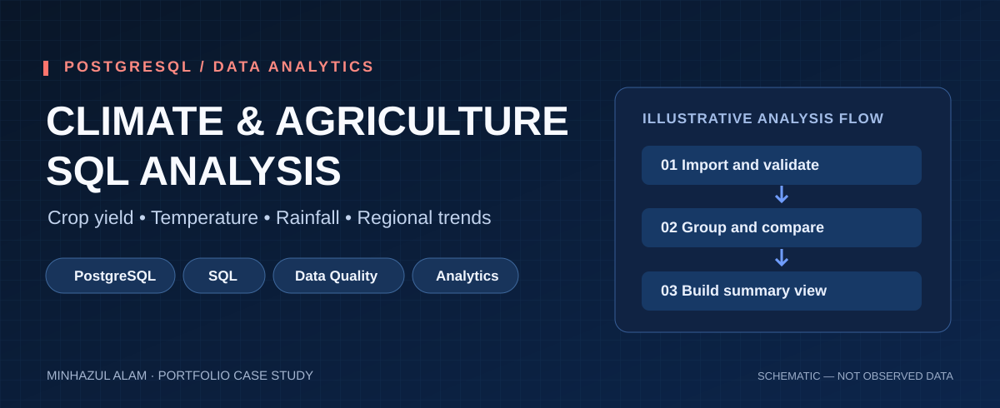

# Climate Change & Agriculture — SQL Analysis



**Category:** Data analytics · Climate and agriculture · SQL portfolio  
**Tools:** PostgreSQL, SQL, data quality checks, aggregations, window functions  
**Author/portfolio:** [Minhazul Alam](https://github.com/minhaz6996)

## Project overview

This portfolio case study documents a PostgreSQL analysis workflow for exploring how climate indicators, agricultural practices, and crop yields vary across years, crops, countries, and regions. It is based on a previously developed climate–agriculture SQL analysis workflow.

The SQL is reusable, but **no original research dataset or verified numerical findings are published here**. You can provide your own approved CSV to run the project. An optional, explicitly **synthetic** seed dataset is included solely to test the SQL.

## PostgreSQL 17 — Verified Local Analysis

The SQL workflow was tested locally in PostgreSQL 17
using a 199-record climate and agriculture dataset.

### Data Quality
| Metric | Result |
|---|---:|
| Total records | 199 |
| Unique records | 199 |
| Duplicate records | 0 |
| Rows with NULL values | 0 |
| Years covered | 1990–2024 |
| Countries | 10 |
| Crop types | 10 |

### Descriptive Statistics
| Indicator | Result |
|---|---:|
| Average temperature | 14.94 °C |
| Average precipitation | 1,559.39 mm |
| Average crop yield | 2.312 MT/ha |
| Average irrigation access | 55.96% |

### Pearson Correlations with Crop Yield
| Variable | Pearson r |
|---|---:|
| Temperature | +0.240 |
| Precipitation | +0.042 |
| Irrigation access | -0.006 |

### SQL Execution Verification
- Q1: Descriptive statistics — Passed
- Q2: Year-wise analysis — Passed
- Q3: Crop-wise performance — Passed
- Q9: Pearson correlation — Passed
- Q10: Window function LAG() — Passed
- Reusable analytical summary view — Passed
- Summary groups: 196
- Source records covered by the view: 199

These are exploratory, dataset-specific findings,
not causal conclusions or national estimates.

The raw dataset is not distributed publicly pending
verification of its source and sharing permissions.

## Analytical questions

1. How do average crop yields and temperatures change year by year?
2. How do crop types and regions differ in average yield and economic impact?
3. What are the reported associations between temperature, precipitation, irrigation access, and crop yield?
4. Which country–crop combinations show year-over-year movement in average yield?
5. Are there missing values or implausible entries that need checking before analysis?

## Dataset structure

Expected CSV filename: `climate_change_impact_on_agriculture_2024.csv` (not distributed). The project expects the PostgreSQL table **`climate`**, with these 15 columns:

| Dimension | Fields |
|---|---|
| Time and geography | `year`, `country`, `region`, `crop_type` |
| Climate | `average_temperature_c`, `total_precipitation_mm`, `co2_emissions_mt`, `extreme_weather_events` |
| Agricultural indicators | `crop_yield_mt_per_ha`, `irrigation_access_percentage`, `pesticide_use_kg_per_ha`, `fertilizer_use_kg_per_ha`, `soil_health_index`, `adaptation_strategies` |
| Impact | `economic_impact_million_usd` |

## Repository structure

```text
climate-agriculture-sql-analysis/
├── README.md
├── assets/
│   └── climate-agriculture-sql.svg
└── sql/
    ├── 00_create_table.sql
    ├── 01_data_quality.sql
    ├── 02_analysis_queries.sql
    ├── 03_summary_view.sql
    └── 99_optional_synthetic_demo.sql
```

## How to run (PostgreSQL)

1. Create an empty PostgreSQL database (e.g., `climate_portfolio`).
2. Run `sql/00_create_table.sql` using pgAdmin Query Tool or `psql`.
3. **Choose one data source:**
   - Your **authorized, real dataset:** import a CSV with exactly the stated schema and matching header order using psql (adjust the path):

     ```sql
     \copy climate FROM 'C:/path/to/climate_change_impact_on_agriculture_2024.csv' WITH (FORMAT csv, HEADER true, ENCODING 'UTF8');
     ```

     `\copy` is a **psql command**, not SQL; in pgAdmin use its Import/Export Data option instead.
   - **No CSV available?** Run `sql/99_optional_synthetic_demo.sql` to insert clearly fictional rows for practice only.
4. Run `sql/01_data_quality.sql` to check the input data.
5. Run `sql/02_analysis_queries.sql` for grouped summaries, trends, relationships, and comparisons.
6. Run `sql/03_summary_view.sql` to create a reusable regional/crop/year view.

> **Important:** Do not run synthetic seed inserts on top of your real dataset. If using a real dataset, only share screenshots or findings after checking accuracy and sharing permissions.

## SQL skills demonstrated

- Data type design and importing structured CSV data
- Data quality checks (nulls, ranges, missing classifications)
- `GROUP BY`, conditional aggregates, CTEs, window functions (`LAG`)
- `CORR` for exploratory associations (without causal claims)
- Building a reusable reporting view

## Interpretation & limitations

This README describes analysis methods and table design, **not validated empirical conclusions**. Correlation does not imply causation; country and crop differences may reflect dataset composition, confounding, or collection methods. Always inspect missingness, source quality, units, and study methods before interpreting results. The cover graphic is illustrative, not a real chart of observed data.

## Related work

- [Power BI: MEH Executive Overview](https://github.com/minhaz6996/meh-executive-overview)
- [Power BI: Sales Performance Overview](https://github.com/minhaz6996/sales-performance-overview)
- [GitHub portfolio](https://github.com/minhaz6996)
